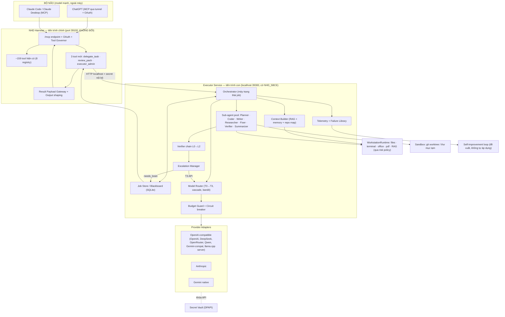
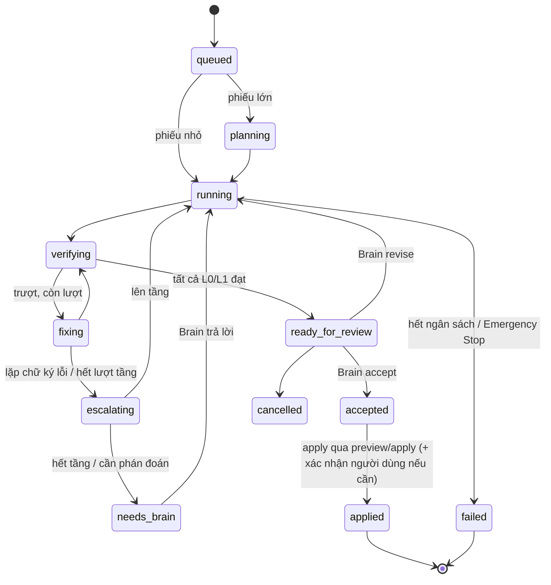
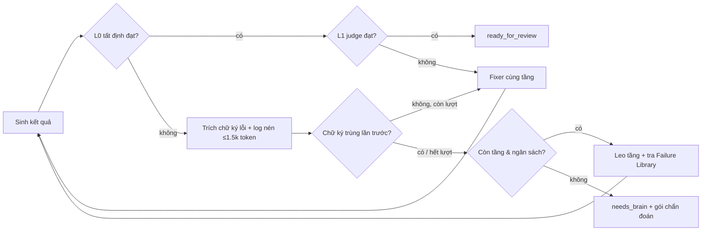
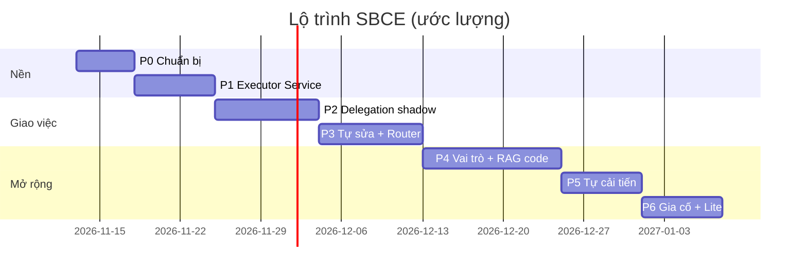

# NHD Harness — Kiến trúc "Strong Brain – Cheap Executor" (SBCE)

> **Loại tài liệu:** Thiết kế kiến trúc + lộ trình + tiêu chí nghiệm thu. **Chưa sửa code, chưa triển khai.**
> **Ngày:** 12/11/2026 · **Trạng thái:** Bản thiết kế v1.1 — đã chốt Q1–Q6 (§17), chờ lệnh bắt đầu P0
> **Phạm vi:** `D:\ChatGPT-Workstation-MCP` (Harness NHD, MCP bridge cho ChatGPT/Claude)
> **Ràng buộc cứng:** (1) giữ nguyên kết nối ChatGPT ↔ NHD qua MCP hiện tại; (2) không phá production; (3) mọi cutover qua quy trình atomic release và phải được người dùng xác nhận từng lần.

---

## Mục lục

1. Tóm tắt điều hành
2. Hiện trạng (as-is) và bài học rút ra
3. Nguyên tắc thiết kế
4. Kiến trúc tổng thể (to-be) + sơ đồ
5. Giao kèo Brain ↔ NHD: Phiếu giao việc & Biên nhận
6. Model Router (bộ định tuyến model)
7. Sub-agent: vai trò, vòng đời, cô lập
8. Vòng tự sửa lỗi và leo thang
9. RAG cho executor
10. Chia sẻ context giữa Brain – Orchestrator – Sub-agent
11. Tiết kiệm token (cả phía Brain và phía Executor)
12. Kiểm chứng chất lượng
13. Tự cải tiến (self-improvement) có kiểm soát
14. An ninh, bí mật, chính sách dữ liệu
15. Bảo toàn production & kết nối ChatGPT MCP
16. Công nghệ đề xuất
17. Quyết định mở cần chủ dự án chốt
18. Lộ trình triển khai theo giai đoạn
19. Tiêu chí nghiệm thu (tổng) và KPI
20. Rủi ro & biện pháp
21. Phụ lục: schema, DDL, cấu hình mẫu, sơ đồ tuần tự
22. Phương án nhà cung cấp: HHTECH API Gateway (catalog thật, phân tầng, chính sách dữ liệu, ước tính chi phí)

---

## 1. Tóm tắt điều hành

**Ý tưởng:** ChatGPT/Claude (model mạnh, đang trả theo gói thuê bao) làm **Bộ não**: hiểu ý người dùng, ra quyết định, viết phiếu giao việc, duyệt kết quả. NHD nhận phiếu qua MCP, tự điều phối **các model giá rẻ qua API** để sinh văn bản, viết code, chạy lệnh, tự kiểm tra và tự sửa; chỉ khi bế tắc mới **leo thang** — trước hết lên model mạnh hơn trong NHD (tốn tiền API, có trần), sau cùng trả về Bộ não kèm gói chẩn đoán gọn.

**Năm quyết định kiến trúc quan trọng nhất:**

| # | Quyết định | Lý do |
|---|---|---|
| D1 | **Bất đồng bộ theo job**: `delegate_task` trả `job_id` ngay; Brain hỏi trạng thái bằng long-poll ≤ 25 s | Tool call của ChatGPT có giới hạn thời gian; việc thật kéo dài phút–giờ |
| D2 | **Kiểm chứng tất định trước, LLM chấm sau** (build/test/schema/QA gate ND30 → judge model khác họ → Brain) | Model rẻ hay "tự nhận là xong"; chỉ bằng chứng máy chạy được mới đáng tin |
| D3 | **Router dạng thác (cascade) có cổng kiểm chứng**, học dần bằng thống kê thành công theo (loại việc × model) | Đa số việc rẻ làm được; chỉ trả giá model mạnh cho phần khó thật |
| D4 | **Brain chỉ nhận "Biên nhận" ≤ 2.000 token**, mọi chi tiết để ở kho artifact, kéo về khi cần | Tiết kiệm context của Brain — tài nguyên đắt nhất trong hệ |
| D5 | **Phần mới chạy trong tiến trình con riêng (Executor Service, cổng localhost 39300)**, bật bằng cờ, mặc định TẮT; `/mcp`, OAuth, tunnel không đổi | Lỗi executor không kéo sập kết nối ChatGPT; rollback bằng tắt cờ |

**Điểm khác biệt so với thiết kế "LLM local" trước đây:** máy hiện tại (i7-11850H, 16 GB RAM, iGPU Intel UHD) đã được benchmark ngày 09/10/2026 — Qwen 1.5B CPU chỉ đạt 62,5 % routing, ~82 % rewrite, latency 1,4–2,5 s, chiếm ~1,4 GB RAM. Vì vậy **executor là model rẻ qua API**, không phải model local. Model local chỉ giữ cho embedding RAG (đã có) và tùy chọn sau này nếu có GPU.

**Kết quả kỳ vọng (mục tiêu nghiệm thu, đo trên bộ việc thật):** giảm ≥ 60 % token Brain cho việc được giao; ≥ 70 % việc được nghiệm thu mà không cần Brain can thiệp ngoài phiếu giao và duyệt cuối; chi phí API trung bình mỗi việc đạt ≤ trần cấu hình; **0 sự cố** ở kết nối ChatGPT MCP và cổng an toàn.

---

## 2. Hiện trạng (as-is) và bài học rút ra

### 2.1 Thành phần đang có (production v0.24.15, nguồn đã lên 0.24.16)

| Thành phần | File chính | Vai trò hiện tại | Tái dùng trong SBCE |
|---|---|---|---|
| MCP server + OAuth + tunnel | `src/server.ts`, `src/mcp.ts`, `src/oauth.ts`, `src/tunnel*.ts` | Kênh ChatGPT/Claude vào NHD | **Giữ nguyên**, chỉ thêm tool |
| 8 domain registry, ~159 tool | `src/mcp-registries/*` | Bề mặt công cụ | Executor gọi lại qua `WorkstationRuntime`, không qua MCP |
| Tool Governor + intent policy | `src/tool-governor.ts` | Chọn quy trình, Execute/Reframe mode | Gợi ý Brain khi nào nên `delegate_task` |
| Tiny Router (trigram Naive Bayes) | `src/tiny-router.ts`, `src/local-intelligence.ts` | Phân loại tức thời, không gọi model | Tầng T0 của Model Router |
| Router tác vụ + risk policy | `src/router.ts`, `src/risk-policy.ts`, `src/task-authorization.ts` | Hợp đồng kiểm chứng, phục hồi, rủi ro | Bắt buộc cho mọi hành động của executor |
| Task Runtime (durable) | `src/task-runtime.ts`, `src/plan-state.ts` | Task, checkpoint, step | Nền cho Job Store |
| Execution Lanes + khóa tài nguyên | `src/execution-lanes.ts`, `src/background-turbo.ts`, `src/isolated-agent.ts` | Chạy nền/cô lập, lock read/write/exclusive, artifact handoff | Lập lịch sub-agent |
| Workspace memory + recall | `src/workspace-memory.ts` | Fact, checkpoint, chat, độ mới | Blackboard dài hạn |
| Project RAG lai (lexical + vector) | `src/project-rag.ts` + worker Python | Truy xuất tài liệu dự án, có trích nguồn | RAG cho executor |
| Result Payload Gateway + Output shaping + Context Handshake | `src/result-payload-gateway.ts`, `src/output-shaping.ts` | Nén output > 16k, gói ngữ cảnh ≤ 2k | Tạo Biên nhận cho Brain |
| Self-Evolution v1 | `src/self-evolution.ts` | Đề xuất sửa SKILL.md từ lỗi đã xác minh ≥ 2 task | Mở rộng cho prompt/role của executor |
| Atomic release | `scripts/atomic-release.mjs`, smoke/cutover | Phát hành bất biến, rollback | Quy trình phát hành không đổi |

### 2.2 Bài học phải giữ

1. **LLM nhỏ chạy CPU không thay được router luật** (12,5–62,5 % so với 100 %). → Router T0 vẫn tất định.
2. **Sự cố 09/11 `[REDACTED]`**: nội dung đã che bị ghi ngược vào mã. → Executor tuyệt đối không được ghi file từ output đã che; thêm "Redaction Guard" ở mọi đường ghi của executor (§14).
3. **Defender chặn `powershell -Command ... Invoke-RestMethod`**. → Gọi API provider bằng `fetch` của Node, không spawn PowerShell.
4. **config.json phải UTF-8 không BOM**; cấu hình mới để file riêng (`executor.json`) để không đụng config hiện hành.
5. **Tool bloat**: đang ~159 tool, kế hoạch gộp còn ~115. → SBCE chỉ thêm **3 tool facade** (§5.4).
6. Người dùng muốn **Harness độc lập**, không phụ thuộc khả năng riêng của Claude → giao kèo Brain–NHD phải trung tính, ChatGPT và Claude dùng như nhau.

---

## 3. Nguyên tắc thiết kế

| # | Nguyên tắc | Hệ quả cụ thể |
|---|---|---|
| P1 | **Brain quyết, Executor làm, Máy chứng minh** | Executor không được tự tuyên bố "đạt"; trạng thái `accepted` chỉ sinh ra từ verifier |
| P2 | **Cộng thêm, không thay thế** | Không sửa transport `/mcp`, OAuth, tunnel, tên/tham số tool hiện có |
| P3 | **Mặc định tắt, bật từng bậc** | Cờ `NHD_SBCE=off/shadow/on`, cờ riêng cho từng role/provider |
| P4 | **Ngân sách là cổng an toàn** | Mỗi job có trần token, tiền, thời gian, số lần thử; vượt → dừng, không "cố thêm" |
| P5 | **Tham chiếu thay vì sao chép** | Context đi bằng handle/hash; Brain kéo chi tiết khi cần |
| P6 | **Cổng an toàn hiện có là tối thượng** | Executor đi qua đúng preview/apply, risk policy, protected path, Emergency Stop, hard-deny credentials/payment |
| P7 | **Học từ bằng chứng đã xác minh, không tự triển khai** | Self-improvement chỉ đề xuất; áp dụng qua review + atomic release |
| P8 | **Trung tính provider** | Mọi model sau một adapter; đổi model = sửa catalog, không sửa code |

---

## 4. Kiến trúc tổng thể (to-be)

### 4.1 Sơ đồ khối



### 4.2 Vì sao tách Executor Service thành tiến trình con

- **Cô lập lỗi:** treo/tràn RAM ở vòng lặp model không làm rơi `/mcp` (ChatGPT vẫn dùng được toàn bộ tool cũ).
- **Rollback rẻ:** tắt cờ → tiến trình con không khởi động; tool mới trả `{"status":"disabled"}`.
- **Giới hạn tài nguyên:** áp `resource-guard` riêng (RAM tối đa, số job song song) phù hợp máy 16 GB.
- **Phát hành chung:** vẫn nằm trong `releases/<id>/dist/`, Electron khởi động cùng backend; không thêm sản phẩm phát hành riêng.

### 4.3 Luồng chính (tóm tắt)

1. Brain gọi `delegate_task` với **Phiếu giao việc** (≈ 300–800 token).
2. NHD kiểm tra phiếu (schema, rủi ro, quyền, ngân sách) → tạo job → trả `job_id` + ước tính.
3. Orchestrator: T0 phân loại → (tùy) Planner chia bước → Context Builder dựng Context Pack → Router chọn model → sub-agent làm → Verifier chạy kiểm tra.
4. Lỗi → Fixer sửa (≤ 2 lần cùng tầng) → leo tầng → hết tầng hoặc cần phán đoán → `needs_brain`.
5. Brain gọi `delegate_task {action:"status", wait_s:25}` hoặc `review_pack` → nhận **Biên nhận** ≤ 2k token → `accept` / `revise` / `reject`.
6. Chỉ khi Brain `accept` (và hành động thuộc nhóm cần xác nhận thì người dùng xác nhận) mới **áp dụng** ra ngoài sandbox.

---

## 5. Giao kèo Brain ↔ NHD

### 5.1 Phiếu giao việc (Work Order) — rút gọn

```jsonc
{
  "title": "Thêm Redaction Guard cho fs_apply_write",
  "kind": "code_change",                // code_change | doc_write | doc_edit | data_extract | research | shell_task | test_write
  "goal": "Từ chối ghi nếu nội dung mới chứa [REDACTED] mà file gốc không chứa",
  "deliverables": ["patch trong worktree", "test mới"],
  "acceptance": [                        // tiêu chí MÁY KIỂM ĐƯỢC ưu tiên
    {"type":"command","run":"npm run build","expect":"exit0"},
    {"type":"command","run":"npm test","expect":"exit0"},
    {"type":"grep_absent","pattern":"\\[REDACTED\\]","paths":["src","electron"],"allow_in_strings":true},
    {"type":"rubric","text":"Không thay đổi hành vi khi file gốc đã chứa [REDACTED]"}
  ],
  "context_refs": ["file:src/files.ts", "rag:D:/ChatGPT-Workstation-MCP?q=fs_apply_write", "memory:fact/redaction-incident"],
  "constraints": ["không sửa test kiến trúc", "giữ chữ ký tool"],
  "locked_paths": ["test/architecture-invariants.test.mjs"],
  "risk": "medium",                      // low | medium | high — NHD tự đánh giá lại, lấy mức cao hơn
  "budget": {"usd": 0.50, "minutes": 30, "max_attempts": 4},
  "escalation": {"allow_t3": true, "ask_brain_on": ["ambiguity","acceptance_conflict"]},
  "apply_mode": "sandbox_only"           // sandbox_only | apply_after_accept
}
```

Quy tắc: thiếu `acceptance` máy kiểm được → NHD tự đề xuất bộ kiểm tra mặc định theo `kind` và ghi rõ trong Biên nhận là "tiêu chí do NHD suy ra".

### 5.2 Biên nhận (Review Pack) — trần 2.000 token

```jsonc
{
  "job_id": "job-…", "status": "ready_for_review",   // queued|running|ready_for_review|needs_brain|failed|accepted|applied|cancelled
  "summary": "Thêm kiểm tra Redaction trong FileService.applyWrite; 1 test mới.",
  "checks": [{"name":"build","ok":true},{"name":"test","ok":true,"detail":"569/569"},{"name":"grep_absent","ok":true}],
  "diff_stat": "src/files.ts +18 −2; test/redaction-guard.test.mjs +41",
  "key_hunks": "…≤ 40 dòng quan trọng nhất…",
  "risks": ["Hành vi đổi với file nhị phân: đã bỏ qua"],
  "open_questions": [],
  "cost": {"usd": 0.07, "tokens_in": 41200, "tokens_out": 3900, "models": ["T1:…","T2:…"], "attempts": 2, "escalations": 0},
  "artifacts": {"diff": "artifact://job-…/diff.patch", "log": "artifact://job-…/test.log", "trace": "artifact://job-…/trace.jsonl"}
}
```

`needs_brain` bổ sung `diagnosis` (giả thuyết lỗi, các cách đã thử, chữ ký lỗi, câu hỏi cụ thể có lựa chọn A/B).

### 5.3 Vì sao bất đồng bộ + long-poll

ChatGPT gọi tool đồng bộ với thời gian chờ giới hạn; việc code+test thường > 1 phút. Long-poll ≤ 25 s/lần cho Brain cảm giác "gần đồng bộ" mà không bị cắt kết nối; Brain có thể làm việc khác giữa các lần hỏi.

### 5.4 Tool MCP mới (chỉ 3, dạng facade theo `action`)

| Tool | Action | Ghi chú |
|---|---|---|
| `delegate_task` | `submit`, `status` (long-poll), `answer` (trả lời needs_brain), `cancel`, `list` | Cổng vào duy nhất |
| `review_pack` | `get`, `accept`, `revise` (kèm chỉ dẫn), `reject`, `pull` (kéo artifact theo đoạn) | `accept` + `apply_after_accept` vẫn qua preview/apply hiện hành |
| `executor_admin` | `status`, `budget`, `catalog`, `eval_report` | Chỉ đọc qua MCP; sửa cấu hình chỉ ở dashboard local |

Mô tả tool viết ngắn, trung tính, ghi rõ "dùng khi việc tốn nhiều token sinh nội dung hoặc lặp sửa–kiểm; không dùng cho câu hỏi ngắn".

---

## 6. Model Router

### 6.1 Các tầng

| Tầng | Bản chất | Dùng cho | Ứng viên trên HHTECH API (giá gộp, đ/1M token — xem §22) |
|---|---|---|---|
| **T0** | Tất định, không gọi model (Tiny Router, regex, template, công cụ có sẵn) | Phân loại, việc có công cụ trực tiếp (đổi tên, tìm, đếm, chuyển định dạng) | Đã có |
| **T1** | Model "nano/flash" rất rẻ, nhanh | Tóm tắt, trích xuất có schema, viết lại, sinh test đơn giản, nén log, judge sơ bộ | `deepseek-v4-flash` 350 · `qwen3-coder-plus` 400 · `claude-haiku-5-5` 400 · `gemini-3.6-flash` 500 · `codex-auto-review` 500 (judge code) |
| **T2** | Model tầm trung giỏi code/viết dài | Sửa code nhiều file, văn bản hành chính dài, sửa lỗi khó vừa | `deepseek-v4-pro` 600 · `gpt-6-luna` 600 · `gemini-3.8-flash` 700 · `glm-5.2` 700 · `gpt-6.1-sol` 800 · `kimi-k3` 1.000 |
| **T3** | Model mạnh qua API (tốn tiền, có trần) | Gỡ bế tắc, thiết kế cục bộ, review rủi ro cao — **chỉ khi Brain không trực tuyến hoặc việc mang tính máy móc nhưng khó** | `gpt-5.6-sol` 1.000 · `claude-sonnet-5-5` 1.200 · (hiếm) `claude-opus-5-5` 2.000 |
| **T4** | **Bộ não** (ChatGPT/Claude qua MCP) | Phán đoán, mơ hồ, xung đột tiêu chí, quyết định sản phẩm | — |

> Bảng trên là **phân tầng ban đầu theo giá**, chưa phải kết luận chất lượng. Vị trí cuối cùng của từng model do Golden Set quyết định ở P1–P2 (§22.4).

> **Nhận định quan trọng về chi phí:** Brain chạy theo thuê bao nên **chi phí tiền biên ≈ 0**, nhưng tốn context của Brain và thời gian người dùng. Do đó: câu hỏi cần *phán đoán* → T4; việc *khó nhưng máy móc* (sửa lỗi build lắt léo) → T3 nếu ngân sách cho phép, tránh làm phiền Brain.

Tên model **không viết cứng trong code**: nằm ở `model-catalog.json` (§21.3) với giá, giới hạn context, khả năng (json_schema, tool_call, vision, prompt_cache), vùng dữ liệu cho phép, trạng thái `enabled`.

### 6.2 Thuật toán định tuyến

```
route(step):
  1. T0: nếu có đường tất định → làm luôn, không gọi model.
  2. Lọc ứng viên theo: capability bắt buộc · context đủ lớn · chính sách dữ liệu (§14.3) · provider không bị circuit-open · còn ngân sách.
  3. Ước độ khó d ∈ [0,1] = f(kind, số file/độ dài, rủi ro, lịch sử lỗi cùng chữ ký, kết quả T0).
  4. Chọn tầng khởi đầu: d<0.35 → T1; d<0.75 → T2; còn lại → T2 kèm “phương án T3 sẵn”.
  5. Trong tầng, chọn model bằng Thompson sampling trên Beta(thành công, thất bại) theo cặp (task_class, model),
     có phạt chi phí: score = sample(p_pass) − λ·cost_norm − μ·latency_norm. λ, μ cấu hình.
     Model mới: “thời gian thử” giới hạn (≤10% lưu lượng, chỉ việc rủi ro thấp).
  6. Cascade: chạy → verifier; trượt → Fixer cùng tầng (≤2) → leo tầng → … → T4.
```

- **Không dùng LLM để định tuyến** (bài học §2.2). Mọi quyết định ghi lý do (`route_reason`) vào trace.
- **Fallback provider:** lỗi 429/5xx/timeout → thử model tương đương provider khác; 3 lỗi liên tiếp → circuit-open 5 phút.
- **Leo T3 tự động** (quyết định Q4): không cần chờ Brain; trần chỉ để chống vòng lặp mất kiểm soát (§17 Q2).

### 6.3 Đầu ra có cấu trúc

Mọi lời gọi executor yêu cầu JSON theo schema (zod → JSON Schema) khi provider hỗ trợ; nếu không, "JSON mode + repair 1 lần bằng T1". Với code: định dạng **SEARCH/REPLACE block** (sửa theo đoạn) thay vì viết lại cả file — vừa rẻ token vừa tránh lỗi kiểu `[REDACTED]`.

---

## 7. Sub-agent

### 7.1 Vai trò

| Role | Tầng mặc định | Đầu vào | Đầu ra (schema) | Công cụ được phép |
|---|---|---|---|---|
| **Planner** | T2 (chỉ khi phiếu lớn và Brain chưa chia bước) | Phiếu + repo map | DAG bước ≤ 8, mỗi bước có acceptance riêng | Đọc |
| **Coder** | T1/T2 | Bước + Context Pack | SEARCH/REPLACE blocks + giải thích ≤ 5 dòng | Đọc, ghi **trong sandbox** |
| **Writer** | T1/T2 | Bước + mẫu/skill + RAG | Văn bản Markdown/khối DOCX có cấu trúc | Đọc, ghi sandbox, Office **preview** |
| **Researcher** | T1 | Câu hỏi | Bằng chứng có trích nguồn (RAG/file) | `project_rag_query`, `fs_search`, `fs_read` |
| **Fixer** | cùng tầng lần trước → leo | Chữ ký lỗi + đoạn log nén + diff | Patch mới | Như Coder |
| **Verifier** | T0 (lệnh) + T1 judge **khác họ model với người làm** | Kết quả + acceptance | Pass/fail từng tiêu chí + lý do | Chạy lệnh kiểm tra trong sandbox |
| **Summarizer** | T1 | Trace/diff/log | Biên nhận ≤ 2k token | Đọc artifact |

Mỗi role = `roles/<name>.md` (prompt hệ thống ổn định để cache) + `tools allowlist` + `output schema` + `tier policy`. Role là **dữ liệu có phiên bản**, nằm dưới `skills/`-style registry để Self-Evolution có thể đề xuất sửa (§13).

### 7.2 Vòng đời job (máy trạng thái)



Trạng thái lưu bền trong SQLite (mở rộng Task Runtime): khởi động lại máy/app → job tiếp tục từ checkpoint, **không phát lại** hành động có tác dụng phụ (giữ nguyên quy tắc no-replay hiện hành).

### 7.3 Cô lập và song song

- **Code:** mỗi job một `git worktree` dưới `D:\NHD-Runtimes\worktrees\<job>` (ngoài `releases/`); áp vào cây chính chỉ sau `accept`, qua preview/apply.
- **Văn bản/Office:** làm trên bản sao trong sandbox; áp dụng vào file thật qua `office_preview_edit` → `office_apply_edit` sẵn có.
- **Song song:** tối đa 3 job, mỗi job tối đa 2 lời gọi model đồng thời; lệnh nặng CPU (build/test) dùng khóa `exclusive` của Execution Lanes → máy 16 GB không quá tải.
- **Không cho executor:** gửi mail/tin, upload, đăng nhập, thanh toán, thao tác trình duyệt phiên người dùng, sửa `releases/`, `runtime/release-state.json`, `C:\ProgramData\ChatGPTWorkstationBridge`, cấu hình bảo mật. Cutover/restart luôn do người dùng xác nhận.

---

## 8. Vòng tự sửa lỗi và leo thang



- **Chữ ký lỗi** = hash của (loại lỗi + file + mã lỗi + thông điệp đã chuẩn hóa bỏ số dòng/đường dẫn tạm). Hai lần cùng chữ ký ⇒ cùng tầng đang "đoán mò" ⇒ leo.
- **Nén log:** giữ dòng lỗi đầu tiên + stack khung liên quan + test fail, bỏ phần lặp; dùng lại logic `Summary:` của Payload Gateway.
- **Failure Library:** chữ ký → cách sửa đã thành công trước đây (đã được nghiệm thu) → nhét vào Context Pack của Fixer. Đây là "trí nhớ sửa lỗi" rẻ nhất.
- **Giới hạn cứng mặc định:** 2 lần/tầng, 6 lần/job, 30 phút, ngân sách job. Hết → dừng sạch, giữ artifact.
- **Chống "gian lận test":** Verifier so diff với `locked_paths`; bất kỳ sửa đổi vào test bị khóa, xóa assertion, `skip`/`only`, hạ ngưỡng → trượt tự động và báo Brain.

---

## 9. RAG cho executor

### 9.1 Nguồn tri thức

| Nguồn | Hiện trạng | Bổ sung |
|---|---|---|
| Tài liệu dự án (DOCX/PDF/MD) | Project RAG lai lexical+vector, trích nguồn | Dùng nguyên; thêm bộ lọc theo `kind` |
| **Mã nguồn** | Chưa có chỉ mục theo ký hiệu | **Code index**: chunk theo hàm/lớp (TS compiler API cho .ts; tree-sitter wasm cho ngôn ngữ khác), lưu symbol, import graph |
| **Repo map** | Chưa có | Bản đồ ≤ 1.500 token: file → ký hiệu export chính, xếp hạng theo đồ thị tham chiếu (PageRank đơn giản) và độ liên quan tới phiếu |
| Workspace memory / quyết định | Có (fact, checkpoint, freshness) | Context Builder truy vấn theo `context_refs` |
| Failure Library | Chưa có | Bảng mới (§21.2) |
| Skill/quy chuẩn (ND30, mẫu văn bản) | Có `skills/` | Writer nạp skill theo `kind` |

### 9.2 Truy xuất cho executor

1. Truy vấn sinh từ phiếu (T0 tách từ khóa; T1 viết lại truy vấn chỉ khi lexical yếu).
2. Hybrid retrieve (đã có) → **rerank** rẻ (điểm lai + độ gần đồ thị import + độ mới) → cắt theo ngân sách token của role.
3. Mỗi đoạn đưa vào prompt gắn nhãn `<<UNTRUSTED source=… locator=…>>`; executor buộc trích `locator` khi khẳng định sự kiện.
4. Không trộn bằng chứng giữa các dự án (giữ quy tắc hiện hành).

### 9.3 Cập nhật chỉ mục

Code index cập nhật tăng dần theo hash file khi job kết thúc hoặc theo `fs_index_watch`; không tự index thư mục ngoài dự án đã được ủy quyền (giữ quy tắc "ingest cần task có ủy quyền").

---

## 10. Chia sẻ context

### 10.1 Ba lớp

| Lớp | Ai giữ | Nội dung | Kích thước |
|---|---|---|---|
| **Ý định & quyết định** | Brain | Mục tiêu người dùng, quyết định sản phẩm, đánh đổi | Context của Brain |
| **Blackboard của job** | Job Store (SQLite) | Phiếu, kế hoạch, quyết định cục bộ, artifact handle, chữ ký lỗi, câu hỏi/đáp với Brain | Không giới hạn, không gửi nguyên |
| **Context Pack** | Context Builder → từng sub-agent | Chỉ phần cần cho *một bước*: mô tả bước, acceptance, đoạn code/RAG đã rerank, repo map rút gọn, kinh nghiệm từ Failure Library | Theo ngân sách role (vd. Coder T1 ≤ 24k, T2 ≤ 60k) |

### 10.2 Quy tắc

- **Truyền tham chiếu:** artifact lưu content-addressed (`artifact://<job>/<sha256>`); dùng lại cơ chế `background_artifact_handle`/`context_payload_artifact` hiện có.
- **Ghi chú bàn giao giữa sub-agent** (handoff note) ≤ 300 token, schema cố định: đã làm gì, giả định, việc còn lại.
- **Không đẩy lịch sử hội thoại** của executor sang bước khác; mỗi bước dựng lại pack từ Blackboard (tránh phình context, tránh lỗi tích lũy).
- **Đồng bộ với Brain:** `ContextHandshakeService` (v0.24.14) bổ sung dòng "Job đang chạy: N, cần anh duyệt: M" vào gói ngữ cảnh ≤ 2k khi Brain kết nối mới.
- **ChatGPT và Claude dùng chung Blackboard:** một job tạo từ ChatGPT có thể được Claude duyệt (ghi `brain_agent` vào lịch sử để truy vết).

---

## 11. Tiết kiệm token

### 11.1 Phía Brain (đắt nhất về context)

| Kỹ thuật | Tiết kiệm ước tính |
|---|---|
| Brain viết phiếu ~500 token thay vì tự sinh code/văn bản hàng chục nghìn token | Lớn nhất |
| Biên nhận ≤ 2k token, chi tiết kéo theo đoạn bằng `review_pack pull` | Tránh nhận log/diff đầy đủ |
| Long-poll + trạng thái chỉ đổi thì mới trả nội dung đầy đủ (`unchanged:true`) | Giảm token hỏi trạng thái |
| Gom nhiều phiếu nhỏ trong một `submit` (batch ≤ 5) | Giảm overhead mỗi lần gọi |

### 11.2 Phía Executor (đắt về tiền)

| Kỹ thuật | Chi tiết |
|---|---|
| **Prompt caching** | Thứ tự prompt cố định: [role system] → [skill/quy chuẩn] → [repo map] → [context bước] → [yêu cầu]. Phần đầu ổn định để hưởng giá cache của provider |
| **Sửa theo đoạn** | SEARCH/REPLACE thay vì viết cả file |
| **Đầu ra có schema, ngắn** | Cấm giải thích dài; `max_tokens` theo role |
| **Nén log/lỗi** | Chữ ký + ≤ 1,5k token |
| **T0 trước** | Việc có công cụ tất định không gọi model |
| **Cascade** | Chỉ trả giá tầng cao cho bước trượt |
| **Batch API** | Eval đêm/ingest không gấp dùng batch (giá thấp hơn) nếu provider có |
| **Dedupe theo hash** | Cùng (prompt, model, nhiệt độ 0) → trả kết quả cache cục bộ (chỉ cho bước thuần, không tác dụng phụ) |

### 11.3 Chỉ số theo dõi

`brain_tokens_per_accepted_job`, `executor_usd_per_accepted_job`, `cache_hit_ratio`, `escalation_rate`, `attempts_per_job`. Mục tiêu ở §19.

---

## 12. Kiểm chứng chất lượng

### 12.1 Thang kiểm chứng

| Mức | Cách | Áp dụng |
|---|---|---|
| **L0 – Tất định** | build, typecheck, test, lint, JSON schema, grep cấm, diff guard, `[REDACTED]` guard, QA gate DOCX/ND30 sẵn có, render PDF so trang | Mọi job có thể |
| **L1 – Judge chéo** | Model T1 **khác họ** với model làm, chấm theo rubric từ `acceptance`, trả lời từng tiêu chí có trích dẫn | Văn bản, tiêu chí dạng rubric |
| **L2 – Kiểm tra mạnh có lấy mẫu** | T3 chấm 100 % việc rủi ro cao, ~10 % việc thường (lấy mẫu) để hiệu chỉnh L1 | Hiệu chỉnh và rủi ro cao |
| **L3 – Brain** | Đọc Biên nhận, `accept`/`revise` | **Mọi job, không ngoại lệ** (quyết định Q5) |
| **L4 – Người dùng** | Xác nhận hành động có tác dụng phụ, cutover | Theo chính sách hiện hành |

### 12.2 Bộ việc chuẩn (Golden Set)

- 40–60 việc **thật** rút từ lịch sử (HANDOFF, CHANGELOG, task runtime): sửa test vỡ, thêm guard, viết công văn ND30, trích xuất bảng PDF, tóm tắt hồ sơ, viết script benchmark…
- Mỗi việc có acceptance máy kiểm được + đáp án tham chiếu.
- Chạy: trước mỗi bản phát hành liên quan SBCE, khi đổi catalog model, và hằng tuần (batch, trần chi phí).
- **Chỉ số chính:** pass@1 theo tầng, pass sau tự sửa, chi phí, độ trễ, tỉ lệ "đạt L0 nhưng Brain từ chối" (đo độ lệch của verifier).

### 12.3 Hiệu chỉnh judge

Mỗi tuần so L1 với L2/Brain trên mẫu; nếu độ đồng thuận < 85 % cho một `task_class` → nâng mức kiểm tra mặc định của lớp đó lên L2 và báo trong `eval_report`.

---

## 13. Tự cải tiến có kiểm soát

| Vòng | Học gì | Từ đâu | Áp dụng thế nào |
|---|---|---|---|
| **Router** | p_pass theo (task_class × model), chi phí thực | Telemetry mỗi lần gọi | **Tự động** cập nhật thống kê bandit (chỉ là số, không đổi code); có trần thăm dò và nút reset |
| **Failure Library** | Chữ ký lỗi → bản sửa đã nghiệm thu | Job `accepted` | Tự động thêm, có TTL và điểm tin cậy |
| **Role/prompt** | Lỗi lặp lại cùng mã ở ≥ 2 job khác nhau đã xác minh | Self-Evolution v1 mở rộng mã lỗi mới (vd. `EXEC_SCHEMA_DRIFT`, `EXEC_TEST_TAMPER`, `EXEC_SCOPE_CREEP`) | **Chỉ đề xuất** ứng viên; đánh giá trên Golden Set; người dùng duyệt; phát hành atomic |
| **Catalog model** | Model mới/giá mới | Người dùng/Brain cập nhật catalog | Model mới vào chế độ thử ≤ 10 % lưu lượng rủi ro thấp; lên chính thức khi Golden Set không kém hơn |
| **Báo cáo** | Tổng hợp tuần | `executor_admin eval_report` | Brain đọc, đề xuất thay đổi |

Giữ nguyên ranh giới Self-Evolution: không sửa skill/policy/quyền/release trực tiếp; ứng viên nằm ngoài `skills/` sống; không lưu nội dung thô của người dùng trong telemetry (chỉ metadata + hash).

---

## 14. An ninh, bí mật, chính sách dữ liệu

### 14.1 Secret Vault

- Khóa API mã hóa bằng **DPAPI (CurrentUser)**, lưu `C:\ProgramData\ChatGPTWorkstationBridge\vault\*.bin` (thư mục đã là SYSTEM_PROTECTED_PATH với tool ghi).
- Chỉ Executor Service giải mã khi gọi provider; khóa **không bao giờ** xuất hiện trong tool output, log, trace, env của tiến trình con khác.
- Nhập khóa chỉ qua dashboard local (người dùng tự gõ), không qua MCP.
- Phương án kỹ thuật: Electron `safeStorage` (dùng DPAPI trên Windows) ở main process + kênh IPC/HTTP localhost có secret nội bộ để cấp khóa theo yêu cầu; **không** dùng PowerShell (Defender, bài học §2.2). Spike chọn phương án ở P1.

### 14.2 Trần chi phí (Budget Guard)

Trần theo job, ngày, tháng, theo provider; cảnh báo 80 %; chặn cứng 100 %. Đếm chi phí theo `usage` provider trả về (không ước tính) và đối soát giá với catalog.

### 14.3 Chính sách dữ liệu ra ngoài

| Nhãn dữ liệu | Ví dụ | Được gửi tới |
|---|---|---|
| `public/code` | Mã nguồn Harness, tài liệu kỹ thuật | Mọi provider trong catalog |
| `internal` | Tài liệu dự án thông thường | Provider được đánh dấu `allow_internal` |
| `personal/sensitive` | Văn bản hành chính có thông tin cá nhân, CCCD, số tài khoản | **Được gửi** (quyết định Q3, 12/11/2026); vẫn ghi nhãn vào trace để truy vết |
| `secret` | Khóa, mật khẩu, token | **Không bao giờ** — hard-deny |

Nhãn suy ra từ đường dẫn + bộ phát hiện PII/secret (dùng lại bộ che hiện có); nhãn cao nhất của Context Pack quyết định provider được phép.

### 14.4 Prompt injection & Redaction Guard

- Nội dung truy xuất/đọc file là dữ liệu không tin cậy; sub-agent không có tool tác dụng phụ ra ngoài nên injection không thể gửi/upload.
- **Redaction Guard**: mọi ghi của executor bị từ chối nếu nội dung mới chứa `[REDACTED]` mà bản gốc không chứa; executor không bao giờ nhận nội dung đã che làm nguồn để ghi lại (đọc nguyên văn nội bộ, chỉ che ở đầu ra gửi Brain/provider).
- Emergency Stop dừng mọi job trong ≤ 2 s (hủy request đang bay, đóng worktree, giữ artifact).

---

## 15. Bảo toàn production & kết nối ChatGPT MCP

### 15.1 Bất biến (không được vi phạm ở bất kỳ giai đoạn nào)

1. Không đổi: đường dẫn `/mcp`, OAuth (`/.well-known/*`, `/oauth/*`), tunnel, cổng 39100, tên/tham số/ngữ nghĩa tool hiện có.
2. `SERVER_INSTRUCTIONS` chỉ **thêm** ≤ 400 ký tự về delegation, không xóa quy tắc (test kiến trúc kiểm tra chuỗi).
3. Tool mới đăng ký qua registry thứ 9 (`delegation-tools.ts`), đi qua wrapper global/Governor như mọi tool (test kiến trúc hiện có phải pass không sửa ý nghĩa).
4. Executor Service tắt → hệ thống hành xử y hệt bản trước (đo bằng smoke + contract test).

### 15.2 Chế độ bật từng bậc

| Chế độ | Hành vi |
|---|---|
| `off` (mặc định) | Không khởi động tiến trình con; 3 tool mới trả `disabled` |
| `shadow` | Job chạy hết vòng nhưng **chỉ trong sandbox**, không bao giờ apply; dùng để đo chất lượng/chi phí trên việc thật |
| `on` | Đầy đủ, apply qua preview/apply + xác nhận |

### 15.3 Kiểm thử bảo vệ kết nối

- **MCP contract test**: liệt kê tool, gọi `runtime_identity`, `workstation_health_fast`, `context_bootstrap` qua đúng transport ChatGPT dùng; so snapshot danh sách tool cũ (chỉ cho phép thêm).
- **Smoke atomic** (cổng 39200) mở rộng: cờ `off` và `shadow` đều phải pass.
- **Kill test**: giết Executor Service giữa job → `/mcp` vẫn trả lời; job chuyển `failed`/tiếp tục sau khởi động lại.
- **Tải**: 3 job song song + Brain dùng tool cũ → p95 tool cũ tăng ≤ 10 %.

### 15.4 Phát hành

Theo đúng quy trình trong `CLAUDE.md`: build → docs:architecture → test 100 % → stage → smoke → verify → **hỏi người dùng** → cutover → `runtime_identity` → cập nhật manifest. Mỗi giai đoạn là ≥ 1 bản phát hành; rollback bằng `atomic-release rollback` hoặc đặt cờ `off`.

---

## 16. Công nghệ đề xuất

| Hạng mục | Lựa chọn | Lý do / thay thế |
|---|---|---|
| Ngôn ngữ | TypeScript trong repo hiện tại | Đồng nhất build/test/release |
| Gọi provider | `fetch` Node + adapter tự viết: **OpenAI-compatible** (phủ OpenAI, DeepSeek, OpenRouter, Qwen/DashScope, Gemini OpenAI-compat, llama.cpp/Ollama server), **Anthropic Messages**, **Gemini native** (tùy) | Ít phụ thuộc, kiểm soát timeout/retry/cache header; tránh spawn PowerShell. Có thể dùng SDK chính thức `openai`, `@anthropic-ai/sdk` nếu muốn — chấp nhận thêm phụ thuộc |
| Schema | `zod` (đã có) → JSON Schema | Structured output + validate |
| Lưu trữ | SQLite hiện có (`db.ts`) thêm bảng `exec_jobs`, `exec_calls`, `exec_failures`, `exec_bandit` | Không thêm DB mới |
| Tiến trình con | `child_process.fork` từ `server.ts` (hoặc Electron khởi động như office-companion), HTTP localhost + secret nội bộ | Cô lập lỗi |
| Cô lập code | `git worktree` + thư mục `D:\NHD-Runtimes\worktrees` | Rẻ, quen thuộc, dễ dọn (chuyển `_archive`) |
| Code index | TypeScript compiler API (có sẵn qua `typescript`), `web-tree-sitter` (wasm, không cần build native) cho ngôn ngữ khác | Tránh module native trên Windows |
| RAG | Project RAG hiện có (Python worker, model embedding cache local) | Không đổi nền tảng |
| Secret | Electron `safeStorage` (DPAPI) hoặc module DPAPI Node — chọn qua spike | Không dùng PowerShell |
| Quan sát | Trace JSONL theo job + bảng tổng hợp + trang dashboard "Executor" | Đã có dashboard Electron |
| Đánh giá | Script `scripts/sbce-eval.mjs` chạy Golden Set, xuất báo cáo MD/JSON | Theo phong cách benchmark hiện có |
| Model local | **Không dùng cho sinh nội dung** trên máy hiện tại; adapter OpenAI-compat sẵn sàng nếu sau này có GPU | Theo benchmark 09/10/2026 |

---

## 17. Quyết định mở cần chủ dự án chốt

| # | Câu hỏi | Đề xuất mặc định |
|---|---|---|
| Q1 | Provider nào được dùng? | **ĐÃ CHỐT 12/11:** chỉ HHTECH API Gateway (§22). Chưa thêm đường dự phòng; khi HHTECH lỗi liên tiếp → circuit breaker → trả `needs_brain`. Kiến trúc vẫn để sẵn chỗ thêm provider khác qua catalog |
| Q2 | Trần chi phí? | **ĐÃ CHỐT 12/11:** chi phí không phải ràng buộc chính; mục tiêu "rẻ nhất mà vẫn đạt chất lượng". Router vẫn ưu tiên tầng rẻ rồi leo dần. Budget Guard chỉ giữ vai trò **chống vòng lặp chạy mất kiểm soát**: 20.000đ/job, 300.000đ/ngày; tháng chỉ cảnh báo, không chặn |
| Q3 | Dữ liệu có được gửi provider ngoài không? | **ĐÃ CHỐT 12/11: được phép**, kể cả văn bản hành chính. Riêng khóa API, mật khẩu, token vẫn **không bao giờ** gửi (cổng an toàn cứng của Harness) |
| Q4 | Cho phép T3 tự chạy không cần hỏi Brain? | **ĐÃ CHỐT 12/11: được**, executor tự leo lên T3 khi tầng dưới bế tắc, không cần chờ Brain |
| Q5 | Có loại việc nào được tự nghiệm thu không qua Brain? | **ĐÃ CHỐT 12/11: không.** Mọi việc đều phải nghiệm thu đủ: L0 (máy kiểm) + L1 (judge khác họ) + Brain duyệt Biên nhận; rủi ro cao thêm L2. Không có chế độ tự accept |
| Q6 | Ưu tiên lĩnh vực đầu tiên: code Harness hay văn bản hành chính? | **ĐÃ CHỐT 12/11:** code Harness trước ở P2–P3 (nghiệm thu hoàn toàn bằng máy); văn bản hành chính mở ở P4 |

> **Tất cả Q1–Q6 đã chốt ngày 12/11/2026.** Có thể bắt đầu P0 khi chủ dự án ra lệnh.

---

## 18. Lộ trình triển khai

> Mỗi giai đoạn: tăng `version`, test 100 %, stage → smoke → verify → **xin xác nhận** → cutover. Mỗi giai đoạn có thể rollback độc lập. Thời lượng là ước lượng công việc, không phải cam kết lịch.

### P0 — Chuẩn bị nền (≈ 3–5 ngày)
- Hoàn tất các việc dở theo HANDOFF (gộp tool, Redaction Guard cho `fs_*`/Office write, đóng gói lại Lite).
- Viết **MCP contract test** + snapshot tool list.
- Dựng **Golden Set v1** (40 việc) từ lịch sử, đo baseline: Brain tự làm hết (token, thời gian).
- **Nghiệm thu P0:** contract test có trong `npm test`; Golden Set chạy được ở chế độ "chấm đáp án có sẵn"; Redaction Guard có test.

### P1 — Nền tảng Executor (≈ 1 tuần)
- Executor Service (tiến trình con, cờ `NHD_SBCE`), Secret Vault, provider adapters (OpenAI-compat + Anthropic), `model-catalog.json`, Budget Guard, circuit breaker, bảng telemetry, trang dashboard.
- **Chưa** đăng ký tool MCP mới.
- **Nghiệm thu P1:** cờ `off` → smoke giống hệt bản trước; gọi thử từng provider qua dashboard local; khóa không xuất hiện trong log/trace (test grep); vượt trần → chặn cứng (test); kill tiến trình con không ảnh hưởng `/mcp`.

### P2 — Delegation MVP, chế độ shadow (≈ 1–1,5 tuần)
- Tool `delegate_task`, `review_pack`, `executor_admin` (đọc); Job Store; role **Coder** + **Summarizer** + Verifier L0; worktree sandbox; Biên nhận ≤ 2k.
- Chỉ `shadow`: không apply.
- **Nghiệm thu P2:** ChatGPT và Claude đều submit/status/review được qua MCP thật; ≥ 50 % Golden Set (phần code) đạt L0 ở shadow; Biên nhận ≤ 2.000 token ở 100 % job; test kiến trúc cũ pass không đổi ý nghĩa.

### P3 — Tự sửa + Router thác + Verifier L1 (≈ 1–1,5 tuần)
- Fixer, chữ ký lỗi, leo tầng, `needs_brain` có gói chẩn đoán, judge chéo họ model, anti test-tamper, Failure Library (ghi).
- Bật `on` cho `kind=code_change` rủi ro thấp/trung bình, apply qua preview/apply.
- **Nghiệm thu P3:** pass sau tự sửa ≥ 70 % Golden Set code; 0 trường hợp sửa `locked_paths` lọt qua (bộ test gian lận cố ý); vòng lặp dừng đúng ở trần (test); escalation_rate 10–30 %.

### P4 — Đủ vai trò + RAG code + Context Pack (≈ 1,5–2 tuần)
- Planner, Writer, Researcher; code index + repo map; Context Builder có ngân sách; prompt caching; handoff note; Handshake báo job.
- Mở `doc_write`/`data_extract` (tuân chính sách dữ liệu Q3; văn bản ND30 qua QA gate sẵn có).
- **Nghiệm thu P4:** Golden Set đầy đủ pass ≥ 70 %; cache_hit_ratio ≥ 40 % trên token input; Brain tokens/việc giảm ≥ 60 % so baseline P0; mọi khẳng định của Researcher có locator.

### P5 — Tự cải tiến (≈ 1 tuần)
- Bandit routing, model thử nghiệm ≤ 10 %, eval tuần, `eval_report`, mã lỗi mới cho Self-Evolution, hiệu chỉnh judge.
- **Nghiệm thu P5:** sau ≥ 2 tuần dữ liệu, chi phí/việc nghiệm thu giảm ≥ 20 % so P4 mà pass không giảm quá 2 điểm %; Self-Evolution tạo được ≥ 1 ứng viên hợp lệ từ lỗi thật, không tự áp dụng.

### P6 — Gia cố & phát hành Lite (≈ 1 tuần)
- Kiểm thử tải/khôi phục, tài liệu vận hành, đóng gói Lite (cờ mặc định `off`), hướng dẫn nhập khóa.
- **Nghiệm thu P6:** 7 ngày chạy `on` liên tục không sự cố MCP; rollback diễn tập thành công; tài liệu `docs/SBCE_OPERATIONS.md`.



---

## 19. Tiêu chí nghiệm thu tổng và KPI

### 19.1 Cổng bắt buộc (fail một cái = không phát hành)

| # | Tiêu chí | Cách đo |
|---|---|---|
| G1 | Kết nối ChatGPT MCP không đổi hành vi | Contract test + snapshot tool (chỉ thêm) + smoke live sau cutover |
| G2 | `npm test` 100 % (gồm test kiến trúc) | CI cục bộ |
| G3 | Cờ `off` ⇒ hành vi bằng bản trước | Smoke 2 chế độ |
| G4 | Không rò khóa API | Test grep log/trace/output + test đơn vị Vault |
| G5 | Cổng an toàn nguyên vẹn (protected path, hard-deny, Emergency Stop, ND30 gate) | Test hiện có + test mới cho executor |
| G6 | Không vượt trần chi phí | Test Budget Guard + đối soát `usage` |
| G7 | Không ghi nội dung đã che | Test Redaction Guard |

### 19.2 KPI mục tiêu (đo trên Golden Set + việc thật ở shadow/on)

| KPI | Mục tiêu |
|---|---|
| Giảm token Brain trên việc được giao | ≥ 60 % |
| Tỉ lệ nghiệm thu không cần Brain can thiệp giữa chừng | ≥ 70 % |
| Pass@1 tầng T1/T2 (L0) | ≥ 45 % ; sau tự sửa ≥ 70 % |
| Escalation rate (lên T3/T4) | 10–30 % |
| Độ đồng thuận judge L1 với L2/Brain | ≥ 85 % |
| Chi phí API/việc nghiệm thu | ≤ trần Q2, giảm ≥ 20 % sau P5 |
| p95 thời gian việc code nhỏ (≤ 3 file) | ≤ 8 phút |
| p95 tool cũ khi có 3 job chạy | tăng ≤ 10 % |
| Sự cố an toàn / sự cố MCP | 0 |

---

## 20. Rủi ro & biện pháp

| Rủi ro | Mức | Biện pháp |
|---|---|---|
| Model rẻ "nói đã xong" nhưng sai | Cao | L0 tất định bắt buộc, judge khác họ, Brain duyệt |
| Executor sửa test để qua | Cao | `locked_paths`, diff guard, phát hiện skip/xóa assertion |
| Vòng lặp tốn tiền | Trung bình | Trần cứng, chữ ký lỗi lặp → leo/dừng |
| Rò dữ liệu cá nhân ra provider | Cao | Nhãn dữ liệu + chặn mặc định + che tự động |
| Provider đổi giá/ngừng model | Trung bình | Catalog cấu hình, fallback chéo provider, eval khi đổi |
| Tool bloat làm Brain chọn sai | Trung bình | Chỉ 3 facade, mô tả ngắn, Governor gợi ý |
| Executor làm chậm/treo máy 16 GB | Trung bình | Tiến trình con, giới hạn song song, khóa exclusive cho build/test |
| Lặp lại sự cố `[REDACTED]` | Cao | Redaction Guard + sửa theo đoạn + không ghi từ output đã che |
| Defender chặn lệnh | Thấp | Không spawn PowerShell gọi mạng; dùng `fetch` |
| Brain không trực tuyến khi `needs_brain` | Thấp | Job chờ, có TTL; T3 theo Q4; Handshake nhắc khi Brain kết nối lại |
| Phụ thuộc một gateway trung gian (HHTECH): sập, đổi giá, đổi/thu hồi model | Trung bình | Circuit breaker → trả `needs_brain`; đường dự phòng (Q1); catalog đồng bộ giá định kỳ; eval khi model đổi |
| Dữ liệu đi qua bên trung gian thứ ba | Trung bình (đã được chấp nhận, Q3) | Không gửi `secret`; ghi nhãn dữ liệu vào trace (§22.3) |

---

## 21. Phụ lục

### 21.1 Sơ đồ tuần tự — việc code điển hình

```mermaid
sequenceDiagram
  participant U as Người dùng
  participant B as Brain (ChatGPT/Claude)
  participant M as NHD /mcp
  participant E as Executor Service
  participant P as Provider (T1/T2/T3)
  participant R as WorkstationRuntime (sandbox)

  U->>B: "Thêm Redaction Guard"
  B->>M: delegate_task submit(Phiếu)
  M->>E: tạo job (kiểm schema/rủi ro/ngân sách)
  E-->>M: job_id, ước tính
  M-->>B: job_id
  E->>R: tạo worktree, dựng Context Pack (RAG + repo map)
  E->>P: Coder T1 (SEARCH/REPLACE)
  P-->>E: patch
  E->>R: áp patch sandbox, build + test
  R-->>E: test fail (chữ ký S1)
  E->>P: Fixer T1 + log nén
  P-->>E: patch 2
  E->>R: build + test → pass
  E->>P: Judge T1 khác họ (rubric)
  P-->>E: đạt
  B->>M: delegate_task status(wait 25s)
  M-->>B: Biên nhận ≤2k token
  B->>M: review_pack accept
  M->>R: preview/apply vào cây chính
  B->>U: Báo kết quả; hỏi xác nhận nếu cần phát hành
```

### 21.2 DDL đề xuất (SQLite)

```sql
CREATE TABLE exec_jobs (
  id TEXT PRIMARY KEY, created_at TEXT, updated_at TEXT,
  brain_agent TEXT, kind TEXT, risk TEXT, status TEXT,
  work_order_json TEXT, plan_json TEXT, review_pack_json TEXT,
  budget_usd REAL, spent_usd REAL, attempts INTEGER, escalations INTEGER,
  task_run_id TEXT, worktree TEXT, data_label TEXT
);
CREATE TABLE exec_calls (
  id TEXT PRIMARY KEY, job_id TEXT, step TEXT, role TEXT, tier TEXT,
  provider TEXT, model TEXT, route_reason TEXT,
  tokens_in INTEGER, tokens_cached INTEGER, tokens_out INTEGER,
  usd REAL, latency_ms INTEGER, outcome TEXT, error_signature TEXT, created_at TEXT
);
CREATE TABLE exec_failures (
  signature TEXT PRIMARY KEY, kind TEXT, sample_digest TEXT,
  fix_digest TEXT, fix_artifact TEXT, confidence REAL,
  seen INTEGER, fixed INTEGER, last_seen TEXT, expires_at TEXT
);
CREATE TABLE exec_bandit (
  task_class TEXT, model TEXT, alpha REAL, beta REAL,
  mean_usd REAL, mean_latency_ms REAL, trial INTEGER, updated_at TEXT,
  PRIMARY KEY (task_class, model)
);
```

Không lưu nội dung thô người dùng trong `exec_calls`; prompt/response đầy đủ chỉ nằm trong trace artifact của job, có hạn lưu (mặc định 14 ngày) và cùng chính sách che.

### 21.3 Cấu hình mẫu

`C:\ProgramData\ChatGPTWorkstationBridge\executor.json` (UTF-8 **không BOM**):

```jsonc
{
  "mode": "off",                         // off | shadow | on
  "maxConcurrentJobs": 3,
  "maxConcurrentCallsPerJob": 2,
  "budgets": {"perJobVnd": 20000, "dailyVnd": 300000, "monthlyVnd": null, "purpose": "anti-runaway"},
  "attempts": {"perTier": 2, "perJob": 6, "jobMinutes": 30},
  "router": {"lambdaCost": 0.3, "muLatency": 0.1, "trialShare": 0.1},
  "dataPolicy": {"personalDefault": "allow", "secret": "never"},
  "retentionDays": 14
}
```

`registry/model-catalog.json` (ví dụ cấu trúc — tên model và giá **phải điền theo bảng giá thực tế lúc triển khai**):

```jsonc
{
  "models": [
    {"id": "t1-a", "tier": "T1", "provider": "provider-a", "model": "<tên-model>",
     "ctx": 128000, "usdPerMIn": 0, "usdPerMCachedIn": 0, "usdPerMOut": 0,
     "caps": ["json_schema", "tool_call", "prompt_cache"], "family": "fam-a",
     "dataLabels": ["public/code", "internal"], "enabled": false},
    {"id": "t3-b", "tier": "T3", "provider": "provider-b", "model": "<tên-model>",
     "ctx": 200000, "caps": ["json_schema", "tool_call", "prompt_cache"], "family": "fam-b",
     "dataLabels": ["public/code"], "enabled": false}
  ]
}
```

### 21.4 Bổ sung đề xuất cho `SERVER_INSTRUCTIONS` (≤ 400 ký tự, chỉ thêm)

> DELEGATION: For work that mainly costs output tokens or repeated fix-and-test loops (multi-file code, long drafts, extraction), prefer `delegate_task` with machine-checkable acceptance, then review via `review_pack`. Do not delegate short answers, user-facing decisions, or actions needing user confirmation.

### 21.5 Danh sách file dự kiến (khi triển khai — chưa tạo)

```
src/executor/service.ts            tiến trình con, HTTP localhost
src/executor/orchestrator.ts       máy trạng thái job
src/executor/router.ts             T0→T3, cascade, bandit
src/executor/context-builder.ts    Context Pack, repo map
src/executor/verifier.ts           L0/L1, diff guard, redaction guard
src/executor/providers/*.ts        openai-compat, anthropic, gemini
src/executor/vault.ts              DPAPI
src/executor/budget.ts             trần chi phí, circuit breaker
src/executor/roles/*.md            prompt vai trò (có phiên bản)
src/mcp-registries/delegation-tools.ts   3 tool facade
scripts/sbce-eval.mjs              chạy Golden Set
test/sbce-*.test.mjs               test đơn vị + contract
docs/SBCE_OPERATIONS.md            vận hành (P6)
```

---

---

## 22. Phương án nhà cung cấp: HHTECH API Gateway (cập nhật 12/11/2026)

Nguồn: trang công khai `https://hhtechapi.com/portal/#/models` và `https://hhtechapi.com/`, đọc ngày 12/11/2026 khi **chưa đăng nhập**. Trang ghi rõ đây là **giá niêm yết, giá áp dụng cho tài khoản có thể khác** → P1 phải đối soát lại sau khi đăng nhập.

### 22.1 Đặc điểm kỹ thuật liên quan

| Hạng mục | Thông tin | Hệ quả thiết kế |
|---|---|---|
| Base URL | `https://hhtechapi.com` | Một endpoint cho mọi model |
| Giao thức | Anthropic Messages `POST /v1/messages` (header `anthropic-version`); OpenAI `POST /v1/chat/completions`; OpenAI Responses (`/v1`, `wire_api="responses"` cho Codex) | Chỉ cần **2 adapter**: Anthropic (cho `claude-*`, dùng `cache_control`) và OpenAI-compatible (cho GPT/Gemini/Grok/DeepSeek/GLM/Kimi/Qwen) |
| Xác thực | `Authorization: Bearer <key>` | Key lưu trong Secret Vault (§14.1), một key cho toàn bộ tầng |
| Đơn vị tiền | Credit; **1.000đ = 1.000 credit** | Budget Guard tính bằng đồng (đ) |
| Cách tính | Theo token thực dùng; mỗi model có "giá gộp"/1M token, nhóm Claude/GPT/Gemini/Grok còn có bảng giá chi tiết input/output/cache | Telemetry ghi cả `usage` trả về lẫn số credit bị trừ để đối soát |
| Model ảnh | GPT Image, Grok Imagine, Gemini Image (tính theo request) | Ngoài phạm vi SBCE; để cho skill media |

**Điểm cần làm rõ ở P1 (spike, ≤ 1 ngày):**
1. "Giá gộp" và "giá có cache" (input/output/cache read/write) cái nào thực sự áp dụng cho request API; với chênh lệch lớn giữa hai cột (ví dụ Sonnet 5.5: gộp 1.200 so với input 1.800 / output 9.000) cần đo bằng request thật rồi xem lịch sử trừ credit.
2. `cache_control` (Anthropic) và prompt caching tự động (OpenAI-compat) có được gateway chuyển tiếp và giảm giá thật không.
3. Structured output: `response_format: json_schema` và tool calling có hoạt động với từng họ model qua gateway không.
4. Giới hạn tốc độ (RPM/TPM), request lỗi có bị trừ credit không (FAQ của trang có mục này — đọc sau khi đăng nhập).
5. Trường `usage` trả về có đầy đủ token cache không.

### 22.2 Catalog đầy đủ (giá niêm yết, đ/1M token)

| Nhóm | Model ID | Giá gộp | Input / Output (cache read) | Tầng đề xuất | Vai trò dự kiến |
|---|---|---:|---|---|---|
| DeepSeek | `deepseek-v4-flash` | 350 | — | T1 | Coder/Summarizer mặc định giá rẻ nhất |
| DeepSeek | `deepseek-v4` (lượt tặng) | lượt tặng | — | Eval | Chạy Golden Set/shadow khi còn lượt tặng |
| Qwen | `qwen3-coder-plus` | 400 | — | T1 | Coder (SEARCH/REPLACE) |
| Claude | `claude-haiku-5-5` | 400 | 900 / 4.500 (90) | T1 | Judge chéo họ cho coder DeepSeek/Qwen; Writer ngắn; trích xuất có schema |
| Claude | `claude-haiku-4.5` | 400 | 900 / 4.500 (90) | Dự phòng T1 | Fallback cho Haiku 5.5 |
| GPT | `codex-auto-review` | 500 | 1.400 / 11.200 (140) | T1 (judge) | Review diff/code ở Verifier L1 |
| Gemini | `gemini-3.6-flash` | 500 | 2.400 / 12.000 (240) | T1 | Researcher, tóm tắt tài liệu dài |
| DeepSeek | `deepseek-v4-pro` | 600 | — | T2 | Coder/Fixer nhiều file |
| DeepSeek | `deepseek-v4.1-flash` | 600 | — | T2 | Thử nghiệm (trial ≤ 10 %) |
| GPT | `gpt-6-luna` | 600 | 1.600 / 8.000 (160) | T2 | Writer văn bản dài, Planner |
| GPT | `gpt-5.6-luna` | 600 | 1.600 / 9.600 (160) | Dự phòng T2 | — |
| Gemini | `gemini-3.7-flash` | 650 | 2.400 / 12.000 (240) | Dự phòng T2 | — |
| Gemini | `gemini-3.8-flash` | 700 | 2.400 / 12.000 (240) | T2 | Researcher context dài |
| GLM | `glm-5.2` | 700 | — | T2 (trial) | Thử nghiệm |
| GPT | `gpt-6.1-sol`, `gpt-6-sol`, `gpt-5.6-terra` | 800 | 1.600 / 8.000–9.600 | T2 | Fixer tầng cao của T2 |
| Grok | `grok-4.5`, `grok-4.6`, `grok-4.7` | 800–900 | 1.600 / 4.800 | T2 (trial) | Thử nghiệm; output rẻ |
| GLM | `glm-5.3-flash` | 850 | — | T2 (trial) | Thử nghiệm |
| Kimi | `kimi-k3` | 1.000 | — | T2 (trial) | Thử nghiệm agent/code |
| GPT | `gpt-5.6-sol` | 1.000 | 4.000 / 24.000 (400) | T3 | Gỡ bế tắc code |
| Claude | `claude-sonnet-5-5` (`claude-sonnet-5`, `claude-sonnet-4.6`) | 1.200 | 1.800 / 9.000 (180) | T3 | Gỡ bế tắc, L2 lấy mẫu, Planner việc lớn |
| Gemini | `gemini-4-argon` | 1.890 | 6.480 / 32.400 (648) | T3 (hiếm) | Ngữ cảnh rất dài |
| Claude | `claude-opus-5-5` (`opus-5`, `opus-4-8/4-7/4-6`) | 2.000 | 4.500 / 22.500 (450) | T3+ (hiếm) | Chỉ khi T3 thường bế tắc và Brain vắng; mặc định **tắt** |
| GPT | `gpt-6-astra` | 2.000 | 8.000 / 40.000 (800) | T3+ (hiếm) | Mặc định **tắt** |
| Claude | `claude-fable-5-1`, `claude-fable-5` | 3.600 | 9.000 / 45.000 (900) | Không dùng tự động | Ngang tầm Brain → để Brain (T4) xử lý thay vì trả tiền |

### 22.3 Chính sách dữ liệu với gateway trung gian

HHTECH là **bên trung gian thứ ba** chuyển tiếp request tới các hãng model. Theo quyết định Q3 (12/11/2026) chủ dự án **cho phép gửi mọi loại dữ liệu công việc** qua gateway, kể cả văn bản hành chính. Giữ lại hai giới hạn:
- **Không bao giờ** gửi `secret` (khóa API, mật khẩu, token, cookie) — đây là cổng an toàn cứng của Harness, không phụ thuộc lựa chọn provider.
- Ghi nhãn dữ liệu của từng Context Pack vào trace để sau này truy vết được việc nào đã gửi gì ra ngoài.

### 22.4 Kế hoạch đánh giá model trên gateway (gộp vào P1–P2)

1. **Smoke (P1):** mỗi model trong 22.2 nhận 3 request chuẩn (JSON schema, SEARCH/REPLACE, tóm tắt tiếng Việt) → ghi độ trễ, `usage`, credit bị trừ, lỗi. Model lỗi định dạng ≥ 2/3 → `enabled:false`.
2. **Golden Set (P2, shadow):** chạy ứng viên T1/T2 trên toàn bộ việc code + văn bản không chứa dữ liệu cá nhân; ưu tiên dùng `deepseek-v4` (lượt tặng) cho các lượt lặp.
3. **Xếp tầng lại** theo `pass_rate / chi_phí` thực đo, không theo giá niêm yết; ghi kết quả vào `docs/SBCE_MODEL_BENCHMARK_<ngày>.md`.
4. **Ghép cặp judge khác họ:** Coder DeepSeek/Qwen ↔ Judge `claude-haiku-5-5` hoặc `codex-auto-review`; Writer GPT ↔ Judge Haiku/Gemini Flash.

### 22.5 Ước tính chi phí mỗi việc (theo giá gộp niêm yết, chưa tính cache)

| Kịch bản | Token ước tính | Model | Chi phí |
|---|---:|---|---:|
| Sửa code nhỏ, đạt ngay | 60k | `deepseek-v4-flash` + judge Haiku 10k | ≈ 25đ |
| Sửa code, 2 lần Fixer + leo T2 | 250k | DeepSeek flash → pro + judge | ≈ 140đ |
| Bế tắc, leo T3 | 250k + 150k | … + `claude-sonnet-5-5` | ≈ 320đ |
| Soạn văn bản dài 10 trang (không dữ liệu cá nhân) | 120k | `gpt-6-luna` + judge Haiku | ≈ 80đ |

Nếu áp dụng bảng giá input/output thay vì giá gộp, chi phí có thể cao hơn khoảng 2–6 lần. Trần đề xuất ở Q2 (5.000đ/job) vẫn dư nhiều lần. Con số thật sẽ thay bảng này sau spike P1.

### 22.6 Mẫu `model-catalog.json` cho HHTECH

```jsonc
{
  "providers": {
    "hhtech": {
      "baseUrl": "https://hhtechapi.com",
      "auth": "vault:hhtech_api_key",
      "protocols": {"anthropic": "/v1/messages", "openai": "/v1/chat/completions"},
      "currency": "VND", "creditPerVnd": 1,
      "dataLabels": ["public/code", "internal"]
    }
  },
  "models": [
    {"id": "t1-deepseek-flash", "provider": "hhtech", "protocol": "openai",    "model": "deepseek-v4-flash", "tier": "T1", "family": "deepseek",  "vndPerM": 350,  "roles": ["coder","summarizer"], "enabled": true},
    {"id": "t1-qwen-coder",     "provider": "hhtech", "protocol": "openai",    "model": "qwen3-coder-plus",  "tier": "T1", "family": "qwen",      "vndPerM": 400,  "roles": ["coder"],               "enabled": true},
    {"id": "t1-haiku",          "provider": "hhtech", "protocol": "anthropic", "model": "claude-haiku-5-5",  "tier": "T1", "family": "anthropic", "vndPerM": 400,  "roles": ["judge","writer","extract"], "caps": ["prompt_cache"], "enabled": true},
    {"id": "t1-codex-review",   "provider": "hhtech", "protocol": "openai",    "model": "codex-auto-review", "tier": "T1", "family": "openai",    "vndPerM": 500,  "roles": ["judge"],               "enabled": true},
    {"id": "t2-deepseek-pro",   "provider": "hhtech", "protocol": "openai",    "model": "deepseek-v4-pro",   "tier": "T2", "family": "deepseek",  "vndPerM": 600,  "roles": ["coder","fixer"],       "enabled": true},
    {"id": "t2-gpt-luna",       "provider": "hhtech", "protocol": "openai",    "model": "gpt-6-luna",        "tier": "T2", "family": "openai",    "vndPerM": 600,  "roles": ["writer","planner"],    "enabled": true},
    {"id": "t2-gemini-flash",   "provider": "hhtech", "protocol": "openai",    "model": "gemini-3.8-flash",  "tier": "T2", "family": "google",    "vndPerM": 700,  "roles": ["researcher"],          "enabled": true},
    {"id": "t3-sonnet",         "provider": "hhtech", "protocol": "anthropic", "model": "claude-sonnet-5-5", "tier": "T3", "family": "anthropic", "vndPerM": 1200, "roles": ["fixer","planner","judge_l2"], "caps": ["prompt_cache"], "enabled": true},
    {"id": "t3-gpt-sol",        "provider": "hhtech", "protocol": "openai",    "model": "gpt-5.6-sol",       "tier": "T3", "family": "openai",    "vndPerM": 1000, "roles": ["fixer"],               "enabled": true},
    {"id": "t3p-opus",          "provider": "hhtech", "protocol": "anthropic", "model": "claude-opus-5-5",   "tier": "T3+","family": "anthropic", "vndPerM": 2000, "roles": ["fixer"],               "enabled": false}
  ]
}
```

`vndPerM` là giá gộp niêm yết để ước tính trước; chi phí thật luôn lấy từ `usage` hoặc lịch sử trừ credit. Khi gateway đổi giá, chỉ cần sửa file này, không phải sửa code.

---

*Hết tài liệu. Q1–Q6 đã chốt (§17); bước tiếp theo: bắt đầu P0 khi chủ dự án ra lệnh. Không có thay đổi code hoặc triển khai nào được thực hiện cùng tài liệu này.*
